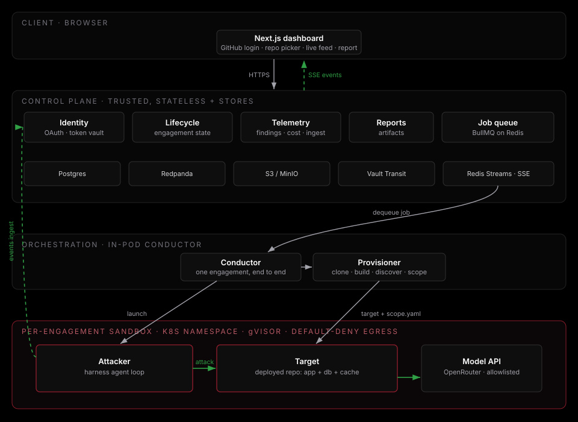
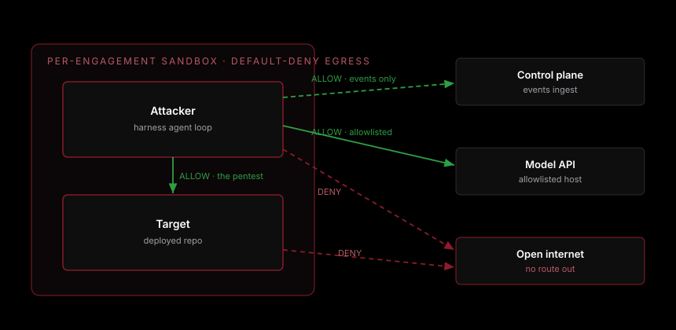
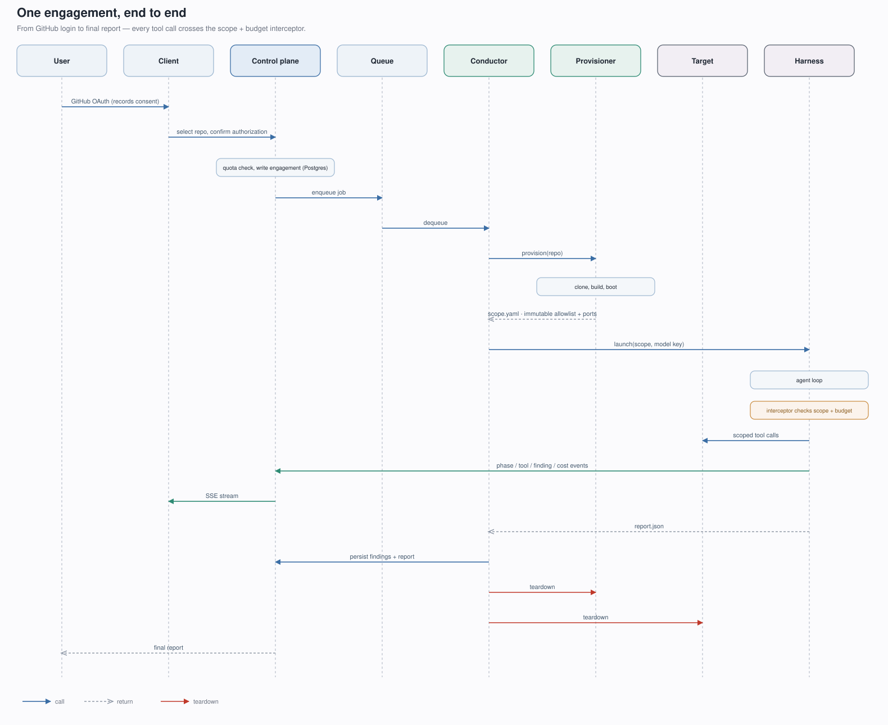
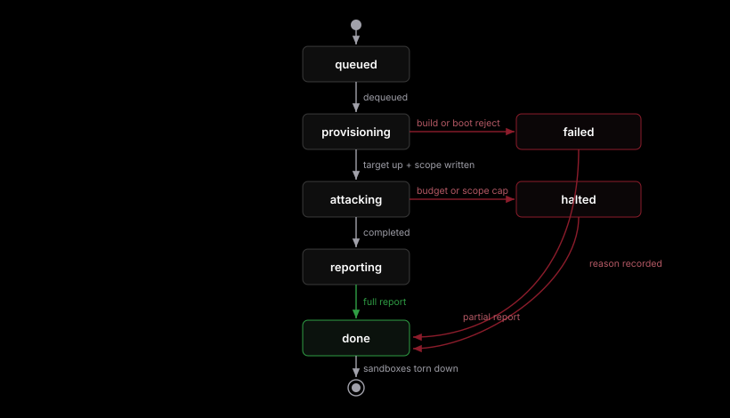
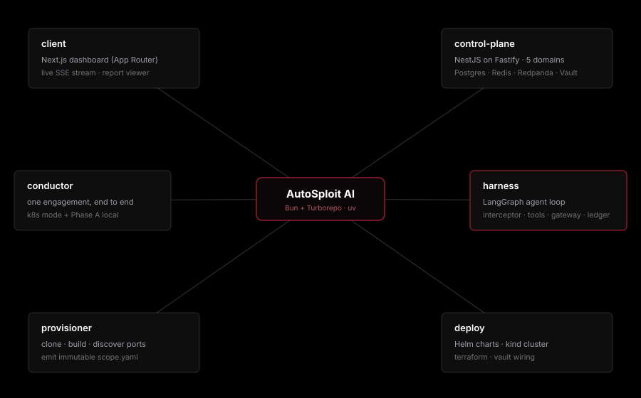
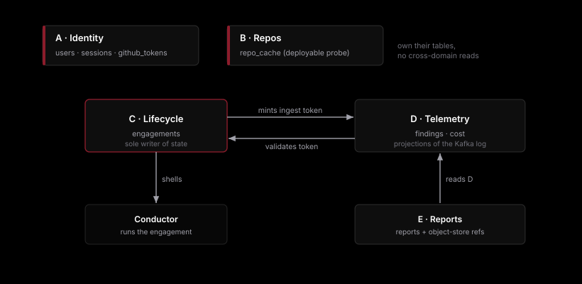

<p align="center">
  
</p>

<p align="center">
  <b>A cloud platform that runs an autonomous penetration test against your own app.</b><br>
  Connect GitHub, pick a repo, watch an AI attack engine exploit it live, and read the report.
</p>

<p align="center">
  
  
  
  
  
  
  
</p>

---

## What it is

AutoSploit AI is a web app that performs an automated penetration test against a user's own
application. A user logs in with GitHub, picks a repo, and the platform deploys that repo into an
isolated sandbox, points an autonomous attack engine at the live instance, and streams the whole
engagement (agent activity, tool calls, findings, cost) to a live dashboard. The run ends in a report.

It is a real product and a full stack plus security engineering project in one: a **client**, an
**API control plane**, a **sandbox provisioning layer** that stands up isolated targets and attackers,
and the **orchestration** to run many engagements safely.

> **Authorized use only.** The platform is built so that you can only ever attack a target it created
> for you from a repo you have access to. Ownership is automatic because the platform spun the target
> up. See [Security model](#security-model). Do not point any part of this at systems you are not
> authorized to test.

---

## Highlights

- **Deploy then attack.** The repo is stood up as a running app, then attacked live. This keeps the
  whole dynamic attack engine useful, and it solves authorization for free (see [the load-bearing decision](#the-load-bearing-decision-deploy-then-attack)).
- **Real isolation, not plain Docker.** Every engagement runs in its own Kubernetes namespace on
  gVisor, with default-deny egress. Exactly two network edges leave the sandbox.
- **Fail-closed scope and budget.** Every tool call crosses a deterministic interceptor that enforces
  an immutable scope allowlist and a spend cap before execution. No LLM sits in that decision.
- **Live by design.** The attack engine emits a typed event stream (phase, tool, finding, cost) that
  flows straight to the dashboard over SSE.
- **One repo, five parts.** A Bun plus Turborepo monorepo: client, control plane, conductor,
  provisioner, and the attack harness, each with its own tests and clear seams.

---

## Architecture

Four planes. The client talks only to the control plane. The control plane is trusted and never
touches untrusted input. The orchestration layer runs one conductor per engagement, which provisions
a sandbox that holds the attacker and the target.

<p align="center">
  
</p>

**Client** handles GitHub OAuth (login plus consent record), the repo picker, the live dashboard, and
the report viewer. **Control plane** holds auth, the engagement service, the job dispatcher, the
telemetry ingest and streaming gateway, and the reports service, backed by Postgres, Redis, Redpanda,
Vault, and object storage. **Orchestration** consumes the queue and runs a conductor per engagement.
**Provisioner** clones the repo, resolves and runs the build, discovers ports, and writes the
immutable scope file the attack engine consumes.

---

## The load-bearing decision: deploy then attack

An automated pentest engine attacks a running target: hosts, services, ports. A GitHub repo is static
source code, so an attack loop has nothing to point at. There are two ways to reconcile that, and they
are genuinely different products.

- **Deploy then attack (DAST), chosen.** Stand the repo up as a running app, then attack the live
  instance. This keeps the entire attack engine useful.
- **Static analysis (SAST), rejected.** Point a scanner at the code. This throws the dynamic attack
  engine away and becomes a different tool.

Deploy also solves authorization. Verifying that a user owns an arbitrary URL is hard and spoofable.
Deploy sidesteps it: GitHub OAuth, the user selects a repo they have access to, the platform deploys it
to its own ephemeral environment, and the engine attacks a target the platform itself created. Scope is
the container you control.

The platform does not build a PaaS. Build is delegated down a fallback ladder:

1. `docker-compose.yml` present, run `compose up`. Best case, since real apps ship a DB and cache.
2. `Dockerfile` present, `docker build` then run.
3. (deferred) Buildpacks or Nixpacks for language auto-detection.
4. None of the above, reject with a clear message.

The MVP ships steps 1 and 2. "Target must be containerized" is a defensible constraint.

---

## Security model

The platform runs offensive tools and executes attacker-influenced code in its own cloud account, so
isolation is the first requirement, not an afterthought.

<p align="center">
  
</p>

Three realities drive the design:

- **Real isolation.** Plain Docker is not a security boundary against hostile in-container code. Each
  engagement runs in its own Kubernetes namespace on gVisor.
- **Locked egress.** An uncontrolled pentest box is an open abuse proxy. Default-deny, allowlist only
  the target and the model API.
- **Enforced scope and logged consent.** The engine may only attack what the user authorized. The
  auto-generated, immutable scope allowlist is the control, enforced server-side.

### Egress matrix: exactly two edges leave the sandbox

| From     | To            | Rule                         |
|----------|---------------|------------------------------|
| Attacker | Target        | **ALLOW** (the pentest)      |
| Attacker | Model API     | **ALLOW** (allowlisted host) |
| Sandbox  | Control plane | **ALLOW** (events only)      |
| Attacker | Open internet | **DENY**                     |
| Target   | Open internet | **DENY**                     |

Kill the internet edges and an in-container escape has nowhere to pivot. Kill the model edge and a run
halts safely rather than reaching out.

---

## How one engagement runs

<p align="center">
  
</p>

Every tool call crosses the scope and budget interceptor. No path skips it. On completion the engine
produces a full report. On a budget or scope cap it halts and produces a partial report. Either way,
both sandboxes are destroyed and nothing offensive outlives the run.

### Engagement lifecycle

<p align="center">
  
</p>

---

## Repository layout

A Bun plus Turborepo monorepo. The TypeScript client and control plane are Bun workspaces. The three
Python services (conductor, provisioner, harness) are managed with `uv`.

<p align="center">
  
</p>

| Path | Language | Responsibility |
|------|----------|----------------|
| [`client/`](client) | TypeScript, Next.js | Operator dashboard: launch engagements, watch them stream, read reports |
| [`control-plane/`](control-plane) | TypeScript, NestJS | Trusted API: auth, persistence, job queue, telemetry fan-out |
| [`conductor/`](conductor) | Python | Owns one engagement end to end: provision, launch, collect, tear down |
| [`provisioner/`](provisioner) | Python | Repo reference to running target plus an immutable `scope.yaml` |
| [`harness/`](harness) | Python | The attack engine: a LangGraph agent loop inside the attacker sandbox |
| [`deploy/`](deploy) | Helm, Terraform | Helm charts, kind cluster, Terraform, Vault wiring |
| [`docs/`](docs) | Markdown | Design records, one per component, plus the platform overview |

### Control plane, one folder per bounded context

Each domain owns its own tables, has a single writer, and exposes one client capability. Cross-domain
coupling is limited to three seams.

<p align="center">
  
</p>

---

## Tech stack

| Layer | Choices |
|-------|---------|
| Client | Next.js 16 (App Router), Tailwind CSS v4, GitHub OAuth, Vitest |
| Control plane | Node 22, NestJS on Fastify, Drizzle plus Postgres, BullMQ on Redis, Redpanda (Kafka API) plus Schema Registry, Redis Streams for the SSE last mile, Vault Transit, S3/MinIO |
| Attack engine | Python 3.12, LangGraph agent loop, OpenRouter model gateway, typed tool adapters, on-disk ledger |
| Orchestration | Python conductor and provisioner, Docker for the local phase, Kubernetes plus gVisor for isolation |
| Isolation and deploy | Self-hosted Kubernetes, gVisor runtime, Cilium network policy, Helm, kind, Terraform |
| Monorepo | Bun workspaces plus Turborepo (TypeScript), uv (Python) |

---

## Getting started

Prerequisites: Node 22, Bun 1.4+, Python 3.12 with `uv`, and Docker (a daemon is needed for the
provisioner and conductor integration tests).

### Client

```bash
cd client
bun install
cp .env.example .env.local   # fill in auth keys
bun run dev                  # http://localhost:3000
```

With no `NEXT_PUBLIC_API_URL` set, the dashboard runs on mock data, so it is fully browsable with no
backend. Set the variable to point it at a live control plane.

### Control plane

```bash
# from the repo root (Bun workspaces + Turborepo)
bun install
bun run build
bun run test        # drift spec + migrations + health on a real Postgres (Testcontainers)

cd control-plane
cp .env.example .env
bun run db:migrate
bun run start:dev
```

### Attack engine (harness)

```bash
cd harness
uv sync
uv run pytest
uv run autosploit-harness run --config configs/run.example.toml
```

### Provisioner

```bash
cd provisioner
uv sync
uv run pytest                  # pure suite, no Docker
uv run pytest -m integration   # needs a Docker daemon
```

---

## Running an engagement

The conductor closes the whole vertical slice in one command: repo to running app to autonomous
exploit to report to cleanup.

```bash
cd conductor
uv sync

# the model key is injected into the harness subprocess only, never the provisioner, never disk
export OPENROUTER_API_KEY=sk-or-...

uv run conductor run https://github.com/juice-shop/juice-shop.git \
  --engagement-id juiceshop --out ./runs
```

This clones the target, builds its Dockerfile, discovers its published port, writes `scope.yaml`, runs
the agent loop against the provisioned scope, writes `runs/<id>/report.json`, and tears the target down.
The surviving artifact is the run record at `runs/<engagement-id>/conductor.json`.

---

## Documentation

The design records live in [`docs/`](docs). Start with the overview, then read the per-component docs.

| Doc | What it covers |
|-----|----------------|
| [`docs/overview.md`](docs/overview.md) | The product, the core decisions, the open questions |
| [`docs/control-plane.md`](docs/control-plane.md) | Bounded contexts, table ownership, the seams |
| [`docs/conductor.md`](docs/conductor.md) | Engagement orchestration and teardown |
| [`docs/provisioner.md`](docs/provisioner.md) | Clone, build, discover, scope emission |
| [`docs/harness.md`](docs/harness.md) | The agent loop, interceptor, tools, gateway |
| [`docs/orchestration.md`](docs/orchestration.md) | Job controller and isolation runtime |
| [`docs/isolation-hardening-roadmap.md`](docs/isolation-hardening-roadmap.md) | The isolation and egress hardening plan |

---

## Build order

Isolation and scale are the last mile, not the first. The project was built to prove the core loop
before making it safe, then making it scale.

1. **Vertical slice.** One hardcoded repo, single machine, no auth or queue. Prove that deploy then
   attack works end to end.
2. **Control plane.** Wrap it with auth, Postgres, engagement CRUD, and a Redis queue.
3. **Isolation hardening.** gVisor and default-deny egress, so untrusted repos are safe to run.
4. **Orchestration at scale.** Job controller, per-engagement teardown, and quotas.

---

## Status

Active development. The full pipeline runs end to end on Kubernetes: a dashboard request flows through
the control plane and conductor, provisions a target, runs the attack engine with live telemetry, and
tears the sandbox down. The attack engine has produced real findings against OWASP Juice Shop
(SQL injection, an admin JWT login, business-logic order injection) in live runs.

> This is a security research and portfolio project. Run it only against applications you are
> authorized to test.
